<div align="center">

<a href="https://webethon.cognifysol.com"></a>

<br/>

<a href="https://webethon.cognifysol.com"></a>
<a href="https://webethon.cognifysol.com/verify"></a>
<a href="#07"></a>
<a href="docs/DEMO.md"></a>

<br/>


<br/>

<a href="#01">Why</a> &nbsp;·&nbsp; <a href="#02">See it</a> &nbsp;·&nbsp; <a href="#03">Features</a> &nbsp;·&nbsp; <a href="#04">Innovation</a> &nbsp;·&nbsp; <a href="#05">Architecture</a> &nbsp;·&nbsp; <a href="#06">Coverage</a> &nbsp;·&nbsp; <a href="#07">Try it</a> &nbsp;·&nbsp; <a href="#08">Run it</a>

</div>

> [!IMPORTANT]
> **Live now at [webethon.cognifysol.com](https://webethon.cognifysol.com).** Every demo account uses the password **`Password@123`**: `admin@exam.test` · `examiner@exam.test` · `candidate1@exam.test`. [All accounts →](#07)

<br/>

<a id="01"></a>


**Examora** is a full-stack platform to **create, conduct, monitor and evaluate** online exams for administrators, examiners and candidates. It is built around three promises:

- **⏱ Fair timing.** The server owns the clock and the database enforces the rules. A device clock, a refresh or a modified browser can't buy extra time.
- **💾 No lost answers.** Every change is saved at once and kept on the device while offline. Answers survive refresh, crash and network drops.
- **✅ Transparent results.** Reports carry a public verification code and a QR code, and candidates can dispute a mark through an accountable process. Every change is audited.


<br/>

<a id="02"></a>


<p align="center">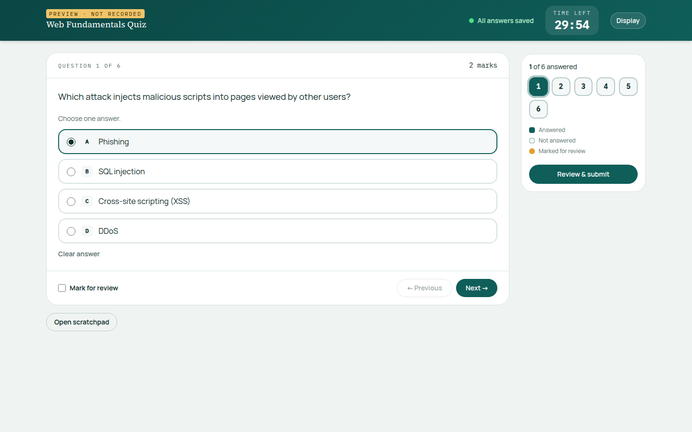</p>
<p align="center"><sub><b>The exam workspace.</b> The timer comes from the server, every answer is saved immediately, and the navigator shows answered, unanswered and flagged questions.</sub></p>

<table>
<tr>
<td width="50%">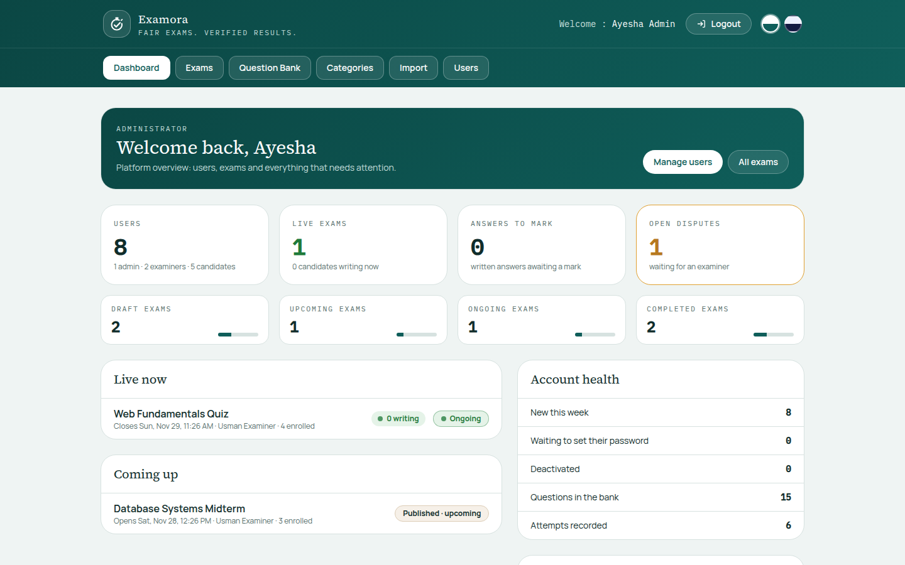<br><sub><b>Admin dashboard.</b> Users, live exams, marking backlog, open disputes and account health at a glance.</sub></td>
<td width="50%">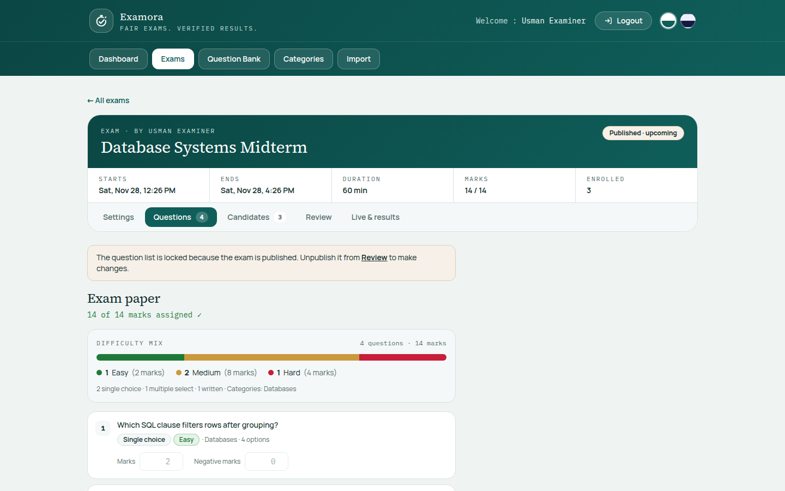<br><sub><b>Exam builder.</b> A difficulty-mix bar, per-exam marks, and locks that follow the exam's lifecycle.</sub></td>
</tr>
<tr>
<td width="50%">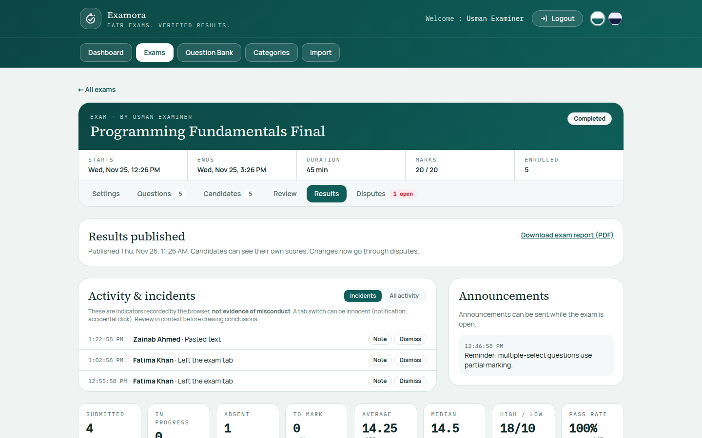<br><sub><b>Results & monitoring.</b> Controlled publishing, incidents marked "not evidence", and summary statistics.</sub></td>
<td width="50%">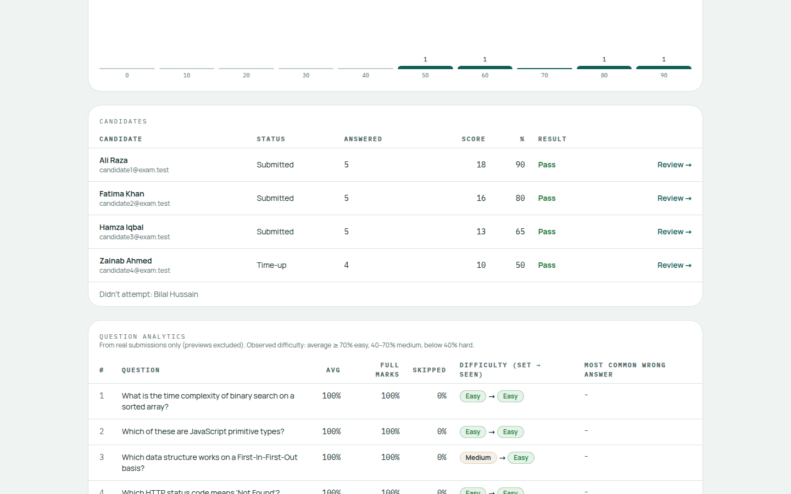<br><sub><b>Question analytics.</b> Average, full-mark rate, skip rate, set vs observed difficulty and the most common wrong answer.</sub></td>
</tr>
<tr>
<td width="50%">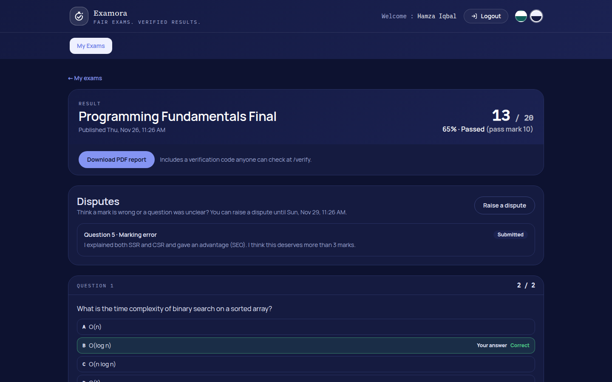<br><sub><b>Candidate result (dark mode).</b> Score, a PDF report with verification code, and disputes.</sub></td>
<td width="50%">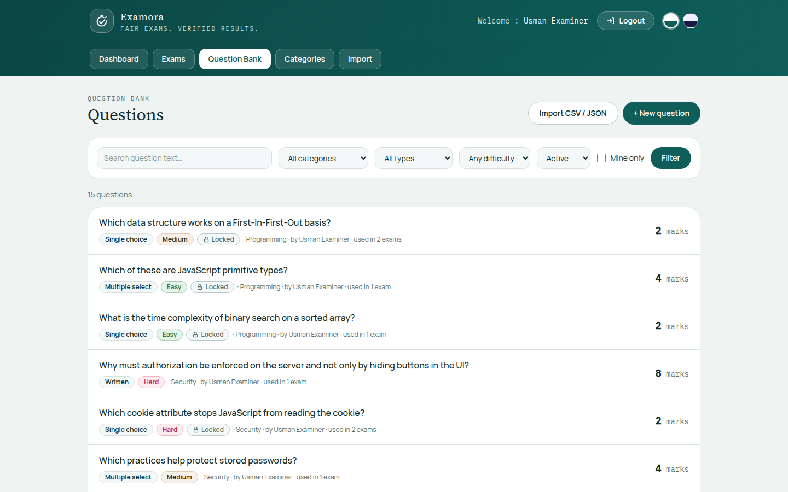<br><sub><b>Question bank.</b> Categories, difficulty, three question types, filters and bulk import.</sub></td>
</tr>
</table>

<br/>

<a id="03"></a>



<details>
<summary><b>🛡️ Administrator</b>: dashboard, users and roles</summary>

<br/>

- **Dashboard:**
  - users by role, live exams, answers to mark, open disputes;
  - exams by phase, plus "Live now" and "Coming up";
  - account health, recent activity and recent sign-ins.
- **Users:**
  - create users of any role, each with a **unique temporary password** shown once in a card with Copy;
  - change roles, activate or deactivate, and reset passwords. Every action needs confirmation and signs the user out everywhere.
- **Guard rails:**
  - an admin can't demote or deactivate themselves;
  - the last admin can't be removed;
  - a candidate with enrollments can't change role.
- Sees and manages **every** exam.

</details>

<details>
<summary><b>🧑‍🏫 Examiner</b>: question bank, exams, monitoring, marking, results</summary>

<br/>

- **Question bank:**
  - categories, difficulty, and three types: single choice, multiple select and written;
  - correct answers are required: exactly 1 for single choice; for multiple select, at least 1 correct and 1 incorrect; the examiner's model answer for written questions;
  - live candidate preview, duplicate, deactivate, and two-tab conflict protection.
- **Bulk import:** CSV/JSON with templates, a dry run with **per-row errors**, and all-or-nothing commit.
- **Exam builder:**
  - schedule in local time, duration, pass marks;
  - all-or-nothing or partial multi-select marking, negative marks;
  - shuffling, a fullscreen requirement, and AI auto-check.
- **Questions tab:**
  - browse the bank or use **random pick** by count × difficulty × category × type;
  - the **total marks follow the questions automatically**;
  - a warning before leaving with unsaved changes.
- **Review & publish:**
  - a checklist that blocks publishing until everything is valid;
  - **Preview as candidate** (sandbox), never counted anywhere.
- **Candidates:** enroll by search, pasted emails or CSV. CSV import creates accounts with **different temporary passwords**.
- **Live monitoring:**
  - progress, time left and last seen;
  - an incident feed with note/dismiss;
  - live announcements.
- **Marking:**
  - automatic objective marking;
  - manual written marking with feedback;
  - **AI suggestions** to accept or override.
- **Results:**
  - controlled publishing;
  - statistics, distribution and question analytics;
  - **exam report PDF**.
- **Disputes:** resolve each one with a response. "Apply to every candidate" raises marks and never lowers them.

</details>

<details>
<summary><b>🎓 Candidate</b>: lobby, workspace, results, disputes</summary>

<br/>

- **Accounts:** public signup creates candidate accounts only.
- **My Exams:** available now, upcoming with a countdown, and completed with scores.
- **Lobby:** rules, including what is recorded (and that there is no camera), and a late-start warning.
- **Exam workspace:**
  - a server timer and a question navigator;
  - autosave with an offline banner;
  - resume after refresh, and auto-submit at the deadline.
- **Display:** text size, split view with **scratchpad**, navigator position, theme and high contrast, saved to the account.
- **Results:**
  - per-question marks and feedback;
  - a **PDF report with verification code + QR**;
  - **raise and track disputes**.

</details>

<br/>

<a id="04"></a>



**5.4 Trust & Dispute Resolution (primary).**

The problem: candidates have no fair, visible way to challenge a mark, and examiners have no accountable way to fix one. Changing scores silently after publication destroys trust.

Examora's answer:
- **A structured dispute:** a category (marking error, ambiguous question, technical problem or other), a written explanation, one open dispute per topic and at most 5 per exam.
- **A required written response.** The candidate sees "your score changed from X to Y".
- **"Apply to every candidate"** for ambiguous questions.

The database guarantees the rest:
- after publication, marks change **only** through this path;
- every decision stores the score before and after;
- the **audit log is append-only**;
- the old PDF code automatically shows **superseded**.

| Also built | What it does |
|---|---|
| **5.3 Failure-resilient exams** | Sequenced autosave (the newest answer wins). An on-device queue survives refresh, crash and offline periods. The deadline is fixed by the server, so offline time still counts. Extending the closing time restores only time that was cut short. The server closes attempts at the deadline with a 2-second transit allowance. |
| **5.1 Integrity in the AI era** | Privacy-friendly signals: tab and window switches, copy/paste, fullscreen exits, with **no camera or microphone**. They are shown as indicators to review, never as proof. Question and option order is shuffled per candidate, and fullscreen can be required. |
| **AI-assisted marking** | One call per written answer: the question, max marks, the examiner's answer and the candidate's answer, with a fixed [`RUBRIC`](src/lib/results/llm.ts). Temperature 0, strict JSON, rounded to ½ mark, and identical answers reuse the result. Prompt-injection attempts are **flagged**. **The examiner always decides.** |

<br/>

<a id="05"></a>



<p align="center">
  
</p>

| Layer | Built with |
|---|---|
| **App** | Next.js 16 App Router, React 19, Server Components, Route Handlers, TypeScript |
| **Styling** | Tailwind CSS 4, CSS-variable themes (light, dark, high contrast) |
| **Data** | PostgreSQL 16 + Prisma 7 (`@prisma/adapter-pg`), 13 versioned SQL migrations |
| **Rules** | 36 CHECK constraints, 16 triggers (incl. deferred constraint triggers), partial unique indexes |
| **Auth** | jose (HS256) + bcryptjs + server-side `sessions` table |
| **Validation** | zod 4, with the same schemas in the browser and on the server |
| **Reports** | pdf-lib + qrcode · **Import:** papaparse · **AI:** any OpenAI-compatible API |

<details>
<summary><b>🔐 Security & data integrity</b></summary>

<br/>

- **Sessions:**
  - an `httpOnly`, `Secure`, `SameSite=Lax` cookie linked to a **server-side session row**, so logout really revokes it;
  - a token-version bump ends every session on a password, role or status change.
- **Role checks:** the role is **always re-read from the database**, never taken from the request. Every API route checks the session, the role and ownership.
- **Brute force:**
  - atomic per-account lockout: 5 failures → 5, 10, 20, then 30 min;
  - per-IP limits on login, signup and verification;
  - the same answer for unknown emails, so attackers can't tell which accounts exist.
- **Discovery:** other users' resources return **404**, so they can't be discovered.
- **Answer keys never leave staff endpoints.** The paper sent to candidates contains no correct flags or model answers.
- **Requests:**
  - same-origin checks against CSRF on every write;
  - `no-store` responses, security headers and HSTS;
  - the server refuses a weak `AUTH_SECRET`.
- **Concurrency:** idempotent start and submit, optimistic locking on edits, race-safe grading.

</details>

<details>
<summary><b>📁 Project structure</b></summary>

<br/>

```
prisma/              schema (17 tables), migrations (constraints + triggers), seed
src/app/             pages: (auth), dashboard, admin, questions, exams/[id]/*, my-exams, attempts, results, verify
src/app/api/         57 JSON route handlers
src/components/      UI: shells, exam workspace, builders, monitor, modals
src/lib/             services: auth, questions, exams, candidate, attempts, results, monitoring, disputes, users
src/lib/validation/  zod schemas shared by client and server
docs/                design notes and demo script
```

</details>

<br/>

<a id="06"></a>


| § | Core requirement | ✓ |
|---|---|:-:|
| 3.1 | Auth & roles: signup (candidates only), bcrypt, revocable sessions, role from DB, server checks, lockout + rate limits, admin user management | ✅ |
| 3.2 | Exam management: draft → published → upcoming/ongoing/completed (server time), settings, publish checklist, lifecycle locks in DB | ✅ |
| 3.3 | Question bank: categories, difficulty, 3 types, import, random pick, paper frozen per attempt | ✅ |
| 3.4 | Candidate management: enroll by search/emails/CSV, unique temporary passwords, window and eligibility enforced | ✅ |
| 3.5 | Exam interface: navigator, server timer, autosave, resume, review & submit, auto-submit | ✅ |
| 3.6 | Monitoring: live attempts, incidents with note/dismiss, announcements | ✅ |
| 3.7 | Grading: objective auto-marking (all-or-nothing/partial/negative), manual + AI-assisted written marking | ✅ |
| 3.8 | Results: controlled publishing, own results only, statistics, attempts retained | ✅ |

| § | Secondary requirement | ✓ |
|---|---|:-:|
| 4.1 | Network-aware: save/connection status, offline banner, auto-resend queue | ✅ |
| 4.2 | PDF reports: candidate result and exam performance | ✅ |
| 4.3 | Sandbox: preview as candidate, never counted | ✅ |
| 4.4 | Bulk import: questions (CSV/JSON) and candidates (CSV) with per-row errors | ✅ |
| 4.5 | Question analytics: average, full-mark rate, skip rate, observed difficulty, common wrong answer | ✅ |
| 4.6 | Verifiable reports: code + QR, public `/verify`, masked name, superseded on change | ✅ |
| 4.7 | Workspace customisation saved to the account | ✅ |
| 4.8 | Scratchpad saved on device and server, never marked | ✅ |

<br/>

<a id="07"></a>


**Live:** https://webethon.cognifysol.com · **Password for every account:** `Password@123` · the login page also has **one-click demo buttons** for each role.

| Role | Email | What to try |
|---|---|---|
| 🛡️ Administrator | `admin@exam.test` | Dashboard, users, roles, password reset |
| 🧑‍🏫 Examiner | `examiner@exam.test` | Question bank, exam builder, monitor, marking, results, disputes |
| 🧑‍🏫 Examiner 2 | `examiner2@exam.test` | Can't open examiner 1's exams (ownership) |
| 🎓 Candidate | `candidate1@exam.test` … `candidate5@exam.test` | Take an exam, results, PDF, disputes |

| Demo exam | State | Shows |
|---|---|---|
| **Web Fundamentals Quiz** | Open now (candidates 1–4) | Taking an exam |
| **Database Systems Midterm** | Opens tomorrow | Upcoming + countdown |
| **Security Basics** | Draft (examiner 2) | Ownership |
| **Programming Fundamentals Final** | Completed, results published | Statistics, analytics, PDFs, an **open dispute** (candidate 3), incidents |

**20-minute test plan:**
1. **Examiner:**
   - **New exam**: opens now, closes in 15 min, 5-min duration, AI-check on;
   - add 2 MCQs and 1 written question → Save (the total updates automatically) → **Publish** → enroll `candidate1`.
2. **Candidate:**
   - Start → answer, and switch tabs once;
   - **refresh**: answers and timer are kept → Review & submit.
3. **Examiner:**
   - Live & results shows the "Left the exam tab" incident; send an announcement;
   - after the exam closes: **Suggest marks with AI** → **Use this mark** → **Publish results**.
4. **Candidate:** download the PDF → `/verify` with its code shows "Authentic" → raise a dispute.
5. **Examiner:** Disputes → accept with a new mark. The candidate's score changes, and the old code shows **superseded**.
6. **Admin:** dashboard → Users → **New user** (temporary password card) → Reset password.

> [!TIP]
> No time to wait for an exam to close? Use **Programming Fundamentals Final** for steps 3–5. It already has published results and an open dispute from `candidate3`.

<br/>

<a id="08"></a>


**Requirements:** Node.js 20+, and Docker (or any PostgreSQL 16).

```bash
# 1. Database
docker run -d --name webethon-pg -e POSTGRES_USER=webethon -e POSTGRES_PASSWORD=webethon_dev \
  -e POSTGRES_DB=webethon -p 127.0.0.1:5444:5432 postgres:16

# 2. App
git clone https://github.com/ahmed-hussain-ai/webethon.git && cd webethon
cp .env.example .env          # set AUTH_SECRET: openssl rand -base64 48
npm install                   # also generates the Prisma client
npm run db:deploy             # tables + database rules
npm run db:seed               # demo data (wipes the database)
npm run dev                   # http://localhost:3110
```

<details>
<summary><b>⚙️ Environment variables</b></summary>

<br/>

| Variable | Required | Purpose |
|---|---|---|
| `DATABASE_URL` | yes | PostgreSQL connection string |
| `AUTH_SECRET` | yes | Signs sessions (≥ 32 random chars; placeholders are refused) |
| `TRUST_PROXY` | behind a proxy | `true` to use `X-Forwarded-For` for per-IP limits |
| `ALLOW_PUBLIC_SIGNUP` | no | `false` disables candidate self-signup |
| `LLM_API_KEY` | no | Enables AI-suggested marks (any OpenAI-compatible API) |
| `LLM_BASE_URL` / `LLM_MODEL` | no | Endpoint and model (default `gpt-4o-mini`; the live demo uses `gpt-4.1-mini`) |
| `APP_URL` | no | Public URL used in report QR codes |
| `COOKIE_SECURE` | no | Only for plain-HTTP deployments |
| `ALLOWED_DEV_ORIGINS` | dev only | Extra hosts allowed to open the dev server |

</details>

<details>
<summary><b>🚀 Scripts & deployment</b></summary>

<br/>

| Command | Purpose |
|---|---|
| `npm run dev` | Development server (port 3110) |
| `npm run build` · `npm start` | Production build and start |
| `npm run lint` | ESLint |
| `npm run db:deploy` | Apply migrations |
| `npm run db:seed` | Reset to demo data (**wipes all data**) |

**Live deployment:**
- Next.js in production mode under **pm2**, bound to `127.0.0.1`;
- **nginx** with Let's Encrypt TLS, HTTP/2 and gzip;
- **PostgreSQL 16** in Docker.

Set `TRUST_PROXY="true"` behind a proxy. HTTPS is required in production (secure cookies).

</details>

| Docs | Contents |
|---|---|
| [DATA_MODEL.md](docs/DATA_MODEL.md) | All 17 tables and every database rule |
| [AUTH.md](docs/AUTH.md) | Authentication, sessions, hardening |
| [QUESTION_BANK.md](docs/QUESTION_BANK.md) | Question bank, validation, import |
| [EXAMS.md](docs/EXAMS.md) | Exam builder, lifecycle, enrollment |
| [CANDIDATE.md](docs/CANDIDATE.md) · [WORKSPACE.md](docs/WORKSPACE.md) | Candidate flow, workspace, autosave, deadline |
| [DEMO.md](docs/DEMO.md) | 15-minute demo script and judge Q&A |

<br/>

<a href="https://webethon.cognifysol.com"></a>
